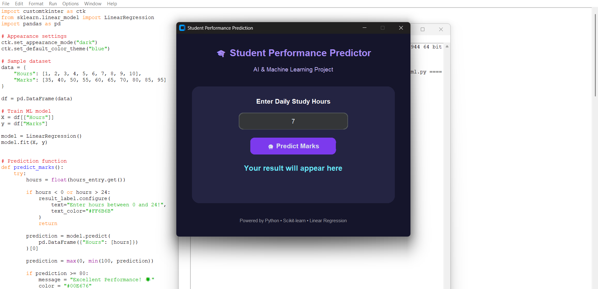
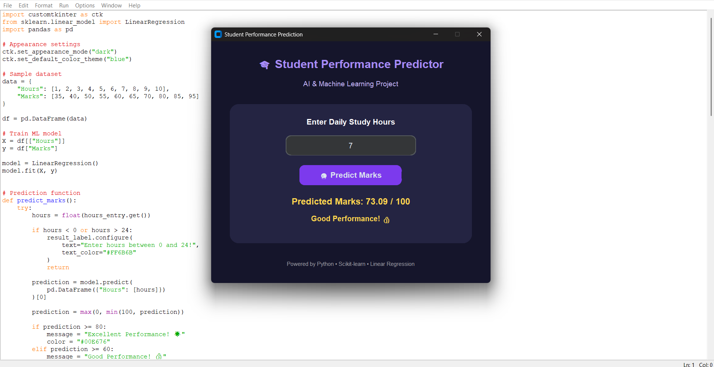

# Student Performance Prediction

## About the Project
This project predicts student marks based on the number of hours they study. It uses Python and Linear Regression to estimate marks. A simple and colorful GUI is created using CustomTkinter, where users can enter their study hours and view the predicted marks.

## Features
* Simple and colorful user interface
* Enter daily study hours
* Predict marks based on study hours
* Display predicted marks instantly
* Show a performance message

## Technologies Used
* Python
* Pandas
* Scikit-learn
* CustomTkinter
* Linear Regression

## How to Run the Project
### 1. Install the Required Libraries

Open Command Prompt and run:
```bash
python -m pip install pandas scikit-learn customtkinter
```

### 2. Run the Program
Save the Python code as `student_gui.py` and run:

```bash
python student_gui.py
```

### 3. Use the Application
1. Open the application.
2. Enter your daily study hours.
3. Click the **Predict Marks** button.
4. View the predicted marks on the screen.

## Sample Output

**Input:**
* Study Hours: 7
### Input Screen


**Output:**
* Predicted Marks: 73.09 / 100
* Performance: Good Performance!
### Output Screen


## Project Objective
The main objective of this project is to understand the relationship between study hours and student marks using a simple Machine Learning model.

## Note
This project uses sample student data for learning purposes. The predicted marks are estimates and may differ from actual examination results.
